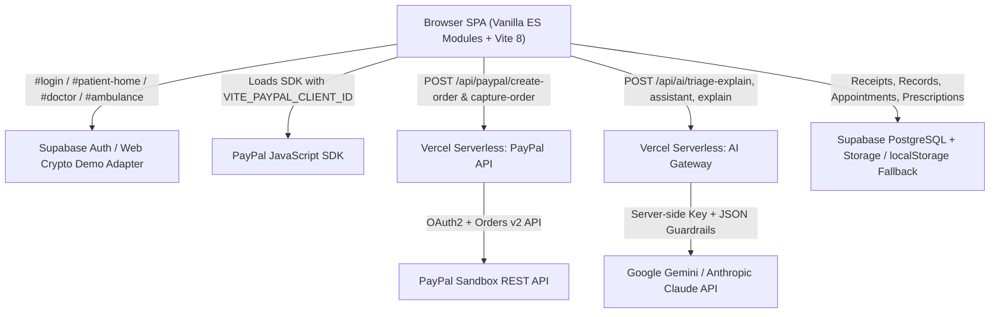

<div align="center">

  

  # HealthVerse
  ### *A Complete Healthcare Universe — Powered by PayPal Sandbox & Real AI*

  **A mobile-first healthcare web platform uniting Patients, Doctors, and Ambulance Responders with AI-assisted triage, guided appointment booking, multilingual medication explanations, and seamless PayPal Sandbox payments.**

  <p align="center">
    <a href="./LICENSE">
      
    </a>
    <a href="https://vitejs.dev">
      
    </a>
    <a href="https://developer.paypal.com/">
      
    </a>
    <a href="https://ai.google.dev/">
      
    </a>
    <a href="https://vercel.com/">
      
    </a>
    <a href="https://supabase.com/">
      
    </a>
  </p>

</div>

---

## Table of Contents

- [Overview](#-overview)
- [How PayPal Is Used](#-how-paypal-is-used)
- [How AI Is Used](#-how-ai-is-used)
- [System Architecture](#-system-architecture)
- [Core Platform Features by Role](#-core-platform-features-by-role)
- [Tools & Technologies Used](#-tools--technologies-used)
- [Getting Started & Setup Instructions](#-getting-started--setup-instructions)
- [Demo Credentials & Testing Guide](#-demo-credentials--testing-guide)
- [Project Structure](#-project-structure)
- [Safety, Security & Known Limitations](#-safety-security--known-limitations)
- [License](#-license)
- [Team & Contact](#-team--contact)

---

## 💡 Overview

Healthcare journeys are often fragmented across disconnected clinics, confusing paper prescriptions, slow emergency coordination, and opaque payment workflows. **HealthVerse** solves this in a single responsive Progressive Web App (PWA) designed mobile-first (`430px` frame) with full tablet and desktop (`1024px+` sidebar) layouts and light/dark themes.

Whether exploring locally with zero external setup in Demo Mode or deployed end-to-end on Vercel with Supabase, PayPal Sandbox, and live LLM inference, HealthVerse connects:
- **Patients** booking specialists, triaging symptoms, paying clinic fees or pharmacy refills, checking live queues, storing records, and triggering SOS dispatch.
- **Doctors** reviewing AI clinical summaries, managing queues, and issuing digital prescriptions with drug/allergy safety checks and patient-friendly explanations.
- **Ambulance Drivers** receiving live SOS dispatches, viewing routes on interactive maps, and updating rescue progress in real time.

---

## 💳 How PayPal Is Used

HealthVerse uses **PayPal Sandbox (Orders v2 REST API + PayPal JavaScript SDK)** to provide real, verifiable online checkout for healthcare consultations and pharmacy refills—while always keeping care accessible via non-online fallbacks (*"Pay later at clinic"* and standard cash-on-delivery refills).

### 1. Where Users Interact with PayPal
- **Doctor Appointment Checkout (`#appointments` → [`appointments.js`](frontend/pages/appointments/appointments.js))**
  - After confirming a hospital, doctor, date, and time slot, patients can either keep **Pay later at clinic** or click **Pay consultation fee with PayPal**.
  - On successful capture, the booking card updates cleanly to a **Paid** badge.
- **Pharmacy Refill Checkout (`#medicines` → [`medicines.js`](frontend/pages/records/medicines.js))**
  - Inside **Order Pharmacy Refill**, users can place a standard refill order or pay the `₹249` refill fee online with PayPal Sandbox.
- **Payment Receipts Center (`#payments` → [`payments.js`](frontend/pages/payments/payments.js))**
  - Linked from Patient Home and Settings, listing all completed PayPal Sandbox transactions stored in `localStorage` (`hv_receipts`) with status badges, transaction IDs, INR/USD amounts, timestamps, and a **Print / Save receipt** button (with text-file download fallback if popups are blocked).

### 2. How the PayPal Integration Works Under the Hood
- **Lazy Client SDK Loading & Currency Transparency ([`paypalService.js`](frontend/services/payments/paypalService.js)):**
  - Dynamically injects `https://www.paypal.com/sdk/js?client-id=<VITE_PAYPAL_CLIENT_ID>&currency=USD&intent=capture` once when needed.
  - Because HealthVerse displays prices in Indian Rupees (`₹`), every checkout widget shows **both the `₹` fee and the USD amount charged**, calculated using `VITE_INR_PER_USD` (default `85`) clearly labeled **demo conversion rate**.
- **Server-Side OAuth2 & Order Creation ([`api/_lib/paypal.js`](api/_lib/paypal.js), [`api/paypal/create-order.js`](api/paypal/create-order.js)):**
  - Keeps `PAYPAL_CLIENT_SECRET` strictly on the server (never bundled to the browser).
  - Caches PayPal OAuth2 client-credentials tokens in memory until near expiry.
  - Validates same-origin `POST` requests (`api/_lib/http.js`), ensures amounts are positive USD `<= 500`, enforces `referenceType` (`"appointment"` or `"medicine"`), attaches a unique `PayPal-Request-Id` header for idempotency, and creates a `CAPTURE`-intent PayPal order.
- **Server-Side Capture & Best-Effort Database Sync ([`api/paypal/capture-order.js`](api/paypal/capture-order.js)):**
  - Captures approved orders server-side and returns `{ status, captureId, amount, currency, payerEmail, createTime }`.
  - Records verified receipts locally (`hv_receipts`) and best-effort syncs non-blocking rows into Supabase's `payments` table without ever interrupting confirmation if DB auth is in demo mode.

---

## 🤖 How AI Is Used

HealthVerse uses a **provider-agnostic serverless LLM layer ([`api/_lib/llm.js`](api/_lib/llm.js))** supporting both **Google Gemini** (default `gemini-3.5-flash` via `x-goog-api-key` header) and **Anthropic Claude** (`x-api-key` + `anthropic-version: 2023-06-01`). All API keys stay strictly on the server, outputs are capped at `700` tokens with `20s` `AbortController` timeouts, JSON is defensively extracted, and endpoints apply per-IP in-memory rate limiting.

### 1. Hybrid AI Triage Explainer ([`api/ai/triage-explain.js`](api/ai/triage-explain.js) + [`triage.js`](frontend/pages/emergency/triage.js))
- **Safety-First Design:** Deterministic rule-based clinical scoring (`triageEngine` in [`data.js`](frontend/services/data.js)) remains authoritative for urgency (`red`, `orange`, `yellow`, `green`)—the LLM can **never lower urgency**, **never diagnose**, and **never prescribe medication**.
- **User Experience:** After completing the 6 screening questions, `#triage` shows a live **Personalized Care Guidance** card (`AI-generated, not medical advice`) summarizing the patient's answers, explaining why the score was assigned, listing supportive non-drug steps, highlighting emergency `108` / `112` red flags, and linking to a recommended specialist in `#appointments`. If offline or unconfigured, the AI card removes itself silently while keeping rule-based triage working 100%.

### 2. Patient AI Health Assistant & Booking Concierge ([`api/ai/assistant.js`](api/ai/assistant.js) + [`ai-assistant.js`](frontend/pages/ai/ai-assistant.js))
- Accessible via **Ask AI** on Patient Home (`#ai-assistant`), maintaining up to the last 6 conversation turns with starter chips (*"I have a fever"*, *"Explain my medicines"*, *"Find a doctor"*, *"Book a cardiologist tomorrow"*), immediate red-flag emergency guidance, skeleton loaders, and inline retry on errors.
- **Human-in-the-Loop Booking Concierge:** When a patient asks to see or book a specialist, the backend returns a structured `{ action: "book_appointment", specialty, preferredDate, reason }` intent. Instead of booking anything automatically, HealthVerse renders an explicit **Review Suggested Appointment Filter** confirmation card—only pre-filtering `#appointments` after the user clicks **Confirm & Open Appointments**.

### 3. Multilingual Plain-Language Medicine & Prescription Explainer ([`api/ai/explain.js`](api/ai/explain.js) + [`explainHelper.js`](frontend/services/ai/explainHelper.js))
- Added **"Explain in simple words"** buttons directly on patient **Medicine Reminders** (`#medicines`) and doctor **Digital Prescriptions** (`#doctor-prescription`).
- Patients or clinicians can toggle live between **English**, **Tamil (`தமிழ்`)**, and **Hindi (`हिन्दी`)** to read clear, jargon-free explanations of what a medicine does, general adherence reminders (explicitly telling patients to follow their doctor's printed label without altering dosages), precautions, and when to contact a doctor.

---

## 🏗️ System Architecture



---

## ✨ Core Platform Features by Role

<details>
<summary><b>Patient Suite</b> (Click to expand)</summary>

- **AI Health Triage (`#triage`) & AI Health Assistant (`#ai-assistant`)** with booking concierge handoff.
- **Hospital Discovery & Specialist Booking (`#appointments`)** with Leaflet interactive maps, specialty filtering, queue wait visibility, and optional **PayPal Sandbox** checkout.
- **Payment Receipts (`#payments`)** with printable/downloadable transaction history.
- **Medicine Reminders & Refills (`#medicines`)** with daily adherence tracking, PayPal refill checkout, and **English / Tamil / Hindi** plain-language explanations.
- **Live Queue Tracker (`#live-queue`)** tracking token position and estimated wait time.
- **Telemedicine Portal (`#telemedicine`)** & **Medical Records Vault (`#health-records`)**.
- **Health Insights (`#health-insights`)** powered by interactive Chart.js visualizations.
- **Emergency SOS (`#sos`)**, **Blood Donation (`#blood-donation`)**, and **Organ Donation Registry (`#organ-donation`)**.

</details>

<details>
<summary><b>Doctor Portal</b> (Click to expand)</summary>

- **Doctor Verification Onboarding (`#doctor-setup`)** with medical license setup.
- **Doctor Dashboard (`#doctor-home`)** showing patient queue, status toggles, and urgent notifications.
- **Patient AI Summary (`#doctor-summary`)** presenting pre-visit vitals and clinical highlights.
- **Digital Prescription Writer (`#doctor-prescription`)** featuring allergy/interaction warnings and **Explain in simple words** previews in English, Tamil, and Hindi.

</details>

<details>
<summary><b>Ambulance Dispatch Portal</b> (Click to expand)</summary>

- **Driver Onboarding (`#ambulance-setup`)** with vehicle registration and verification banner.
- **Live SOS Dispatch Dashboard (`#ambulance-driver`)** with availability toggles, incoming emergency coordinates, and active rescue status progression.

</details>

---

## 🛠️ Tools & Technologies Used

| Category | Tools, Libraries & Services | Where Used |
|---|---|---|
| **Frontend Core** | Vanilla JavaScript (ES Modules), HTML5, CSS3 (Design Tokens, `[data-theme="dark"]`, Responsive Sidebar at `>=1024px`, `prefers-reduced-motion`) | `frontend/`, `index.html`, `frontend/styles/style.css` |
| **Build & Tooling** | Vite `8.1.5`, Node.js `18+`, npm | `package.json`, `vite build` |
| **Serverless Backend** | Vercel Serverless Node.js Functions (native `fetch`, `crypto.randomUUID`, ES module handlers) | `api/_lib/`, `api/paypal/`, `api/ai/` |
| **Payments** | PayPal JavaScript SDK (`currency=USD&intent=capture`), PayPal Sandbox REST Orders v2 & OAuth2 Client Credentials | `frontend/services/payments/paypalService.js`, `api/paypal/*` |
| **Generative AI / LLMs** | Google Gemini API (`gemini-3.5-flash` default via `x-goog-api-key`), Anthropic Messages API (`claude-3-5-sonnet-latest` via `x-api-key`) | `api/_lib/llm.js`, `api/ai/*` |
| **Database & Auth** | Supabase (`@supabase/supabase-js` `2.110.8`, PostgreSQL 15 19-table schema, Auth, Storage), Firebase Web SDK (`13.0.0`), Browser Web Crypto API (SHA-256 demo fallback) | `frontend/services/supabase/`, `frontend/services/firebase/`, `database/schema/` |
| **Maps, Charts & Icons** | Leaflet `1.9.4` + OpenStreetMap tiles, Chart.js `4.4.6`, Lucide Icons `0.460.0`, Inline SVG UI Icons | `index.html`, `appointments.js`, `health-insights.js`, `frontend/utils/icons.js` |
| **PWA & Security** | Web App Manifest (`public/manifest.json`), `escapeHtml` output encoding (`utils.js`), Same-origin POST guard (`http.js`), Per-IP rate limiting (`llm.js`) | `public/manifest.json`, `frontend/utils/utils.js`, `api/_lib/` |

---

## ⚙️ Getting Started & Setup Instructions

### 1. Prerequisites
- **Node.js `18+`** and **npm `9+`** (Node 18+ provides built-in `fetch` and `crypto.randomUUID` for `/api/*` functions)
- **Vercel CLI** (`npx vercel dev`) if running both Vite frontend and `/api/*` serverless functions locally together
- **PayPal Developer Sandbox Account** (free at [developer.paypal.com](https://developer.paypal.com/)) for live sandbox order capture
- **Google AI Studio Key** ([aistudio.google.com](https://aistudio.google.com/)) or **Anthropic API Key** ([console.anthropic.com](https://console.anthropic.com/)) for AI endpoints
- *(Optional)* **Supabase** project if persisting records/appointments beyond Demo Mode (`localStorage`)

### 2. Clone & Install
```bash
git clone https://github.com/TS-Anusha27/healthverse.git
cd healthverse
npm install
```

### 3. Configure Environment Variables
Copy `.env.example` into a gitignored `.env.local` file for local development:

```bash
cp .env.example .env.local
```

Update `.env.local` with your values (**never put `AI_API_KEY` or `PAYPAL_CLIENT_SECRET` in `VITE_*` variables or commit `.env.local`**):

| Variable | Required For | Scope | Description |
|---|---|---|---|
| `VITE_PAYPAL_CLIENT_ID` | PayPal UI Buttons | Browser (`VITE_`) | PayPal Sandbox Client ID loaded by the PayPal JS SDK |
| `VITE_INR_PER_USD` | PayPal UI Conversion | Browser (`VITE_`) | INR → USD demo conversion rate (default: `85`) |
| `PAYPAL_CLIENT_ID` | `/api/paypal/*` | Server Only | Matching PayPal Sandbox REST App Client ID |
| `PAYPAL_CLIENT_SECRET` | `/api/paypal/*` | Server Only | Matching PayPal Sandbox REST App Secret (`E...`) |
| `PAYPAL_ENV` | `/api/paypal/*` | Server Only | `sandbox` (default) or `live` |
| `AI_PROVIDER` | `/api/ai/*` | Server Only | `"gemini"` (default) or `"anthropic"` |
| `AI_API_KEY` | `/api/ai/*` | Server Only | Your Gemini or Anthropic secret key |
| `AI_MODEL` | `/api/ai/*` | Server Only | Optional override (defaults: `gemini-3.5-flash` / `claude-3-5-sonnet-latest`) |
| `VITE_SUPABASE_URL` / `VITE_SUPABASE_ANON_KEY` | Optional Cloud DB | Browser (`VITE_`) | Supabase project URL and anon key (falls back to Demo Mode if omitted) |

### 4. *(Optional)* Initialize Supabase Schema
If connecting your own Supabase project, run the SQL migration inside [`database/schema/02_full_supabase_migration.sql`](database/schema/02_full_supabase_migration.sql) in the **Supabase Dashboard → SQL Editor**.

### 5. Run Locally
```bash
# Recommended: Run Vite SPA + Vercel /api/* serverless endpoints together
npx vercel dev

# Frontend-only UI preview (PayPal UI & Demo Auth work; /api/* requires vercel dev or deployment)
npm run dev

# Build production static bundle (outputs to dist/)
npm run build
```

### 6. Deploy to Vercel
1. Import the repository from GitHub (`main` branch) in Vercel (Vite + `/api/*.js` ES modules are auto-detected).
2. Add all `VITE_*` and server-only environment variables in **Project Settings → Environment Variables**.
3. Trigger a **Deploy / Redeploy** so Vite bakes `VITE_*` variables cleanly into the production build.

---

## 🧪 Demo Credentials & Testing Guide

You can test every role immediately on `#login` without setting up Supabase:

1. **One-Click Login (`#login`):** Click **"Continue with Demo User"** to enter instantly, or sign in manually using:
   - **Patient:** `patient@demo.com` / `demo123`
   - **Doctor:** `doctor@demo.com` / `demo123`
   - **Ambulance Driver:** `driver@demo.com` / `demo123`
   - **Demo Phone/Email OTP:** `123456` (displayed in the demo OTP helper hint)
2. **Test AI Triage (`#triage`):** Complete the 6 screening questions on Patient Home → **Triage AI** to see the rule-engine urgency card followed by the live **Personalized Care Guidance** AI card.
3. **Test AI Assistant & Concierge (`#ai-assistant`):** Open **Ask AI**, send *"I have a fever"* for Q&A or *"Book a cardiologist tomorrow"* to test the human-in-the-loop **Confirm & Open Appointments** card.
4. **Test Multilingual Explainer (`#medicines` / `#doctor-prescription`):** Click **Explain in simple words** on any medicine or prescription item and switch between **English**, **தமிழ் (Tamil)**, and **हिन्दी (Hindi)**.
5. **Test PayPal Sandbox Checkout (`#appointments`, `#medicines`, `#payments`):**
   - Book any hospital appointment → choose **Pay consultation fee with PayPal** (or **Pay later at clinic**).
   - Or open **Medicines → Refill** → **Pay Online with PayPal**.
   - Approve with a PayPal Sandbox personal buyer test account to view the **Paid** badge, print/save receipt, and inspect `#payments`.

---

## 📂 Project Structure

```text
healthverse/
├── api/                                  # Vercel Serverless Functions (Node 18+ ES Modules)
│   ├── _lib/
│   │   ├── http.js                       # Same-origin POST enforcement, JSON parser, sanitization
│   │   ├── llm.js                        # Gemini & Anthropic wrapper, timeout, retry, rate limit
│   │   └── paypal.js                     # OAuth2 token cache & PayPal Orders v2 helper
│   ├── ai/
│   │   ├── assistant.js                  # POST /api/ai/assistant (chat + booking intent)
│   │   ├── explain.js                    # POST /api/ai/explain (English / Tamil / Hindi)
│   │   └── triage-explain.js             # POST /api/ai/triage-explain
│   └── paypal/
│       ├── create-order.js               # POST /api/paypal/create-order
│       └── capture-order.js              # POST /api/paypal/capture-order
├── frontend/
│   ├── pages/
│   │   ├── ai/                           # ai-assistant.js, health-insights.js
│   │   ├── ambulance/                    # ambulance-driver.js, ambulance-setup.js
│   │   ├── appointments/                 # appointments.js, live-queue.js
│   │   ├── auth/                         # login.js, patient-registration.js, usertype.js, splash.js
│   │   ├── bloodDonation/                # blood-donation.js, organ-donation.js
│   │   ├── doctor/                       # doctor-dashboard.js, doctor-prescription.js, doctor-setup.js, doctor-summary.js
│   │   ├── emergency/                    # sos.js, triage.js
│   │   ├── patient/                      # patient-home.js
│   │   ├── payments/                     # payments.js (#payments receipts page)
│   │   ├── profile/                      # notifications.js, settings.js
│   │   ├── records/                      # health-records.js, medicines.js
│   │   └── telemedicine/                 # telemedicine.js
│   ├── routes/router.js                  # Role-protected hash router
│   ├── services/
│   │   ├── ai/explainHelper.js           # Multilingual plain-language explainer modal
│   │   ├── auth/                         # authService.js, demoAuthAdapter.js
│   │   ├── payments/paypalService.js     # Dynamic SDK loader, INR->USD conversion, receipts
│   │   ├── supabase/                     # Supabase client, auth, db, storage
│   │   ├── firebase/                     # Optional Firebase client helpers
│   │   └── data.js                       # Deterministic triage engine & fallback mock datasets
│   ├── store/store.js                    # Client reactive state & theme store
│   ├── styles/style.css                  # Design tokens, dark mode & responsive layouts
│   ├── utils/                            # demoUsers.js, icons.js, utils.js (escapeHtml, modals, states)
│   └── main.js                           # Application entry point & route registration
├── database/schema/                      # PostgreSQL 15 / Supabase SQL migrations
├── docs/                                 # Additional API, Architecture, Setup & DB docs
├── public/                               # manifest.json, favicon.svg, icons.svg
├── .env.example                          # Placeholder environment variables template
├── CHANGELOG.md                          # Release & hackathon commit history
├── LICENSE                               # OSI-approved MIT License
└── package.json                          # Dependencies & Vite scripts
```

---

## 🔒 Safety, Security & Known Limitations

- **Clinical Safety:** Triage urgency (`triageEngine`) is rule-based; AI modules only explain results, answer general health questions, or translate medication instructions with explicit `"AI-generated, not medical advice"` labels and `108` / `112` emergency prompts.
- **Secret Isolation & Input Safety:** PayPal secrets and AI keys stay inside server environment variables via `api/_lib/*`. Dynamic UI strings (including AI responses) are escaped with [`escapeHtml`](frontend/utils/utils.js) before insertion.
- **Sandbox & Local Fallback Scope:** Rate limiting in `api/_lib/llm.js` is best-effort per warm serverless instance. Live PayPal capture requires both `PAYPAL_CLIENT_ID` and `PAYPAL_CLIENT_SECRET` configured on the server; otherwise booking and refills fall back smoothly to pay-at-clinic / cash-on-delivery modes.
- **Pre-Existing Repository Note:** `.env` was historically tracked before `.gitignore` updates; rotate any legacy public Supabase/Firebase keys if rotating credentials for production.

---

## 📄 License

This project is open source and licensed under the **OSI-approved MIT License** — see [`LICENSE`](LICENSE) for the full license text (`Copyright (c) 2026 HealthVerse Team`).

---

## 👥 Team & Contact

- **Repository:** [https://github.com/TS-Anusha27/healthverse](https://github.com/TS-Anusha27/healthverse)
- **Maintainers:** [TS-Anusha27](https://github.com/TS-Anusha27) · [ashwinsiva007](https://github.com/ashwinsiva007)
- **Changelog:** See [`CHANGELOG.md`](CHANGELOG.md)
- **Issues & Contributions:** [Open an issue](https://github.com/TS-Anusha27/healthverse/issues) or submit a Pull Request!
