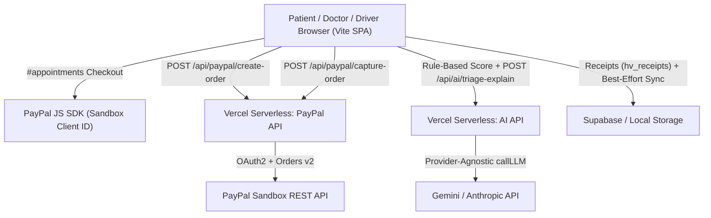

<div align="center">

  <!-- PROJECT LOGO -->
  

  # 🏥 HealthVerse
  ### *A Complete Healthcare Universe*

  **Empowering patients, doctors, and emergency responders through a unified, AI-driven digital healthcare ecosystem.**

  ---

  <!-- SHIELDS BADGES -->
  <p align="center">
    <a href="https://github.com/TS-Anusha27/healthverse/blob/main/LICENSE">
      
    </a>
    <a href="https://github.com/TS-Anusha27/healthverse/releases">
      
    </a>
    <a href="https://vitejs.dev">
      
    </a>
    <a href="https://supabase.com">
      
    </a>
    <a href="https://github.com/TS-Anusha27/healthverse/stargazers">
      
    </a>
    <a href="https://github.com/TS-Anusha27/healthverse/issues">
      
    </a>
    <a href="#contributing">
      
    </a>
  </p>

  <!-- BANNER -->
  <br />
  
  <br />
  <br />

</div>

---

## 🏆 PayPal AI Hackathon Edition (Overview & Architecture)

**HealthVerse** is a mobile-first healthcare companion built with **Vanilla ES Modules + Vite 8** and **Vercel Serverless Functions**, serving **Patients**, **Doctors**, and **Ambulance Drivers** with digital triage, emergency SOS dispatch, specialist booking, pharmacy refills, digital prescriptions, health records, and community blood donation.

### What Was Added for the Hackathon

1. **Real PayPal Sandbox Checkout (`/api/paypal/*`)**
   - Server-side OAuth2 client-credentials flow with in-memory token caching (`api/_lib/paypal.js`) and same-origin request enforcement (`api/_lib/http.js`).
   - `POST /api/paypal/create-order` validates USD amounts (`> 0` and `<= 500`), enforces `referenceType` (`"appointment"` or `"medicine"`), attaches an idempotency `PayPal-Request-Id`, and creates a `CAPTURE`-intent PayPal order.
   - `POST /api/paypal/capture-order` captures the order and returns verified `{ status, captureId, amount, currency, payerEmail, createTime }`.
   - Frontend `frontend/services/payments/paypalService.js` dynamically loads the PayPal JS SDK when `VITE_PAYPAL_CLIENT_ID` is configured, converts INR display prices to USD using `VITE_INR_PER_USD` (default `85`, labeled **demo conversion rate**), stores receipts in `localStorage` (`hv_receipts`), and attempts a non-blocking Supabase `payments` sync.
   - Optional consultation checkout inside `#appointments` (with **"Pay later at clinic"** option and `"Paid"` badge), pharmacy refill PayPal checkout inside `#medicines` (`orderRefillModal`), and a dedicated **Payment Receipts** screen (`#payments`) accessible from Patient Home and Settings.

2. **Real AI Health Guidance (`/api/ai/*`)**
   - Provider-agnostic serverless wrapper (`api/_lib/llm.js`) supporting **Google Gemini** (`x-goog-api-key`) and **Anthropic Claude** (`x-api-key`), capped at 700 output tokens, 20-second `AbortController` timeouts, defensive JSON parsing, and per-IP in-memory rate limiting.
   - `POST /api/ai/triage-explain` pairs rule-engine urgency levels (`red | orange | yellow | green`) with structured, non-diagnostic explanations, red-flag emergency reminders (`108` / `112`), safe supportive steps, and a suggested medical specialty rendered in `#triage` (`AI-generated, not medical advice`), falling back silently if offline or unconfigured.
   - `POST /api/ai/assistant` powers the `#ai-assistant` chat screen (with quick starter chips and human-in-the-loop **Booking Concierge** confirmation cards that pre-fill `#appointments` ONLY after explicit user confirmation).
   - `POST /api/ai/explain` powers **"Explain in simple words"** modals on `#medicines` and `#doctor-prescription` with **English**, **Tamil (`தமிழ்`)**, and **Hindi (`हिन्दी`)** language switching.

### Architecture Diagram



### Local Setup & Vercel Deployment

#### Prerequisites
- Node.js `18+` (for native `fetch` and `crypto.randomUUID` in serverless handlers)
- Optional: Vercel CLI (`npx vercel dev`) to run Vite + `/api/*` routes together locally

#### Environment Variables

Copy `.env.example` to `.env.local` (never commit `.env.local`):

| Variable | Scope | Purpose |
|---|---|---|
| `VITE_PAYPAL_CLIENT_ID` | Client (Vite) | PayPal Sandbox Client ID passed to PayPal JS SDK |
| `VITE_INR_PER_USD` | Client (Vite) | Demo conversion rate (default `85`) |
| `PAYPAL_CLIENT_ID` | Server only | PayPal Sandbox REST Client ID |
| `PAYPAL_CLIENT_SECRET` | Server only | PayPal Sandbox REST Secret |
| `PAYPAL_ENV` | Server only | `sandbox` (default) or `live` |
| `AI_PROVIDER` | Server only | `"gemini"` or `"anthropic"` |
| `AI_API_KEY` | Server only | Server-side Gemini or Anthropic API key |
| `AI_MODEL` | Server only | e.g. `gemini-3.5-flash` or `claude-3-5-sonnet-latest` |

```bash
npm install
# Option A: Full stack locally (Vite frontend + /api/* serverless functions)
npx vercel dev

# Option B: Production frontend bundle check
npm run build
```

On Vercel, add the server-only variables (`PAYPAL_CLIENT_ID`, `PAYPAL_CLIENT_SECRET`, `PAYPAL_ENV`, `AI_PROVIDER`, `AI_API_KEY`, `AI_MODEL`) and client `VITE_*` variables in **Project Settings → Environment Variables**.

### Judge Testing Guide

1. **Instant Demo Login (`#login`)**
   - Click **"Continue with Demo User"** on the login page to enter in one click, or sign in with:
     - **Patient:** `patient@demo.com` / `demo123`
     - **Doctor:** `doctor@demo.com` / `demo123`
     - **Ambulance Driver:** `driver@demo.com` / `demo123`
   - Phone/OTP sign-in in demo mode uses code `123456` (as shown in the OTP prompt hint).
2. **Test Real AI Health Triage (`#triage`)**
   - From Patient Home, open **AI Triage**, answer the 6 screening questions, and observe both the deterministic urgency badge and the live **Personalized Care Guidance** card (`AI-generated, not medical advice`).
3. **Test Real AI Assistant & Booking Concierge (`#ai-assistant`)**
   - From Patient Home, open **Ask AI** (`#ai-assistant`), try quick chips like *"I have a fever"* or *"Book a cardiologist tomorrow"*, and verify that booking suggestions show a confirmation card before opening pre-filtered `#appointments` (never auto-booking).
4. **Test Plain-Language Explainer (`#medicines` & `#doctor-prescription`)**
   - Click **"Explain in simple words"** on any medicine reminder card or prescription cart item and switch between **English**, **தமிழ் (Tamil)**, and **हिन्दी (Hindi)**.
5. **Test Optional PayPal Sandbox Payment (`#appointments`, `#medicines`, `#payments`)**
   - Book any hospital doctor appointment and confirm slot/date, OR open **Medicine Reminders → Refill** (`#medicines`).
   - Choose **"Pay later at clinic"** / standard order, or pay via **PayPal Sandbox** to see the ₹ INR to USD conversion rate (`1 USD = ₹85`), **Paid** badge, printable receipt in `#payments`, and **Print / Save receipt** action.

### Tech Stack & Known Limitations

- **Frontend:** Vanilla JS (ES modules), CSS design tokens (light/dark theme), Vite 8, Lucide Icons, Chart.js
- **Backend / Serverless:** Vercel Node.js Functions (`/api/*`), PayPal Orders v2 API, Google Gemini / Anthropic Messages API, Supabase (optional persistence)
- **Known Limitations:**
  - Rule-based triage scoring in `frontend/services/data.js` remains authoritative; AI outputs never diagnose or lower urgency.
  - Per-IP AI rate limiting is in-memory per warm serverless instance (best-effort protection).
  - Real PayPal capture requires both `PAYPAL_CLIENT_ID` and `PAYPAL_CLIENT_SECRET` in server environment variables; when omitted, the UI falls back cleanly so **"Pay later at clinic"** and core booking continue uninterrupted.

---

## 📌 Table of Contents

- [About HealthVerse](#-about-healthverse)
- [Vision](#-vision)
- [Features](#-features)
  - [Patient Suite](#-patient-suite)
  - [Doctor Portal](#-doctor-portal)
  - [Ambulance Dispatch](#-ambulance-dispatch)
  - [Hospital Queue & Management](#-hospital-queue--management)
  - [AI Engine](#-ai-engine)
- [Tech Stack](#-tech-stack)
- [System Architecture](#-system-architecture)
- [Database Architecture](#-database-architecture)
- [Folder Structure](#-folder-structure)
- [Screenshots](#-screenshots)
- [Installation](#-installation)
- [Usage Guide](#-usage-guide)
- [Why HealthVerse is Unique](#-why-healthverse-is-unique)
- [Security & Compliance](#-security--compliance)
- [Future Roadmap](#-future-roadmap)
- [Team](#-team)
- [Contributing](#-contributing)
- [License](#-license)
- [Contact](#-contact)
- [Acknowledgements](#-acknowledgements)

---

## 💡 About HealthVerse

Healthcare systems worldwide face immense friction: patients suffer long waiting times, critical medical records are fragmented across clinics, emergency response times are delayed, and doctors are overburdened by manual data entry.

**HealthVerse** bridges these gaps by providing an enterprise-grade digital health universe connecting patients, physicians, ambulance networks, blood banks, and hospitals in real time.

### 🚩 Key Healthcare Challenges Solved

| Problem | Traditional Healthcare | HealthVerse Solution |
|---|---|---|
| **Doctor Shortage & Triage** | Patients wait hours regardless of severity | **AI Symptom Triage** automatically ranks queue priority |
| **Hospital Waiting Queues** | Crowded, unpredictable waiting rooms | **Live Queue Tracker** with real-time token count & ETA |
| **Emergency Delays** | Slow manual 108/911 dispatch | **One-Tap Emergency SOS** with instant GPS location sharing |
| **Fragmented Records** | Paper prescriptions & lost test reports | **Encrypted Cloud Vault** accessible anywhere via ABHA |
| **Rural Healthcare Access** | Limited specialist availability | **Telemedicine Video Portal** connecting rural patients to specialists |
| **Blood & Organ Shortages** | Critical delays finding compatible donors | **Real-Time Donor Registry** & automated hospital matching |
| **Medication Errors** | Dangerous drug-drug & allergy interactions | **AI Drug Conflict Engine** alerting doctors before prescription |

---

## 🎯 Vision

> *"To revolutionize global healthcare accessibility by creating an intelligent, borderless healthcare ecosystem where every patient receives immediate triage, transparent care, and life-saving emergency intervention."*

---

## ✨ Features

<details>
<summary><b>👨‍👩‍👧‍👦 Patient Suite</b> (Click to expand)</summary>

<br />

- 🤖 **AI Health Assistant**: Interactive symptom checker and health risk assessment.
- 🗄️ **Medical Record Vault**: Secure PDF, scan, and lab report storage backed by Supabase Storage.
- 📋 **AI Medical Summarization**: Instant multi-page record synthesis into digestible patient summaries.
- 📅 **Online Appointment Booking**: Multi-specialty doctor discovery with QR code confirmations.
- ⏱️ **Live Queue Tracker**: Real-time position tracking and estimated consultation wait times.
- 📹 **Telemedicine Video Consultations**: Integrated WebRTC signaling for remote care.
- 🚨 **One-Tap Emergency SOS**: Auto-dispatches nearest ambulance and alerts emergency contacts.
- 🩸 **Blood Donation Network**: Live blood bank availability search and active donor requests.
- 🫀 **Organ Donation Registry**: Secure organ donor pledging linked to national registries.
- 💊 **Smart Medicine Reminders**: Pill tracking, dosage schedules, and 1-click pharmacy refills.
- 🏥 **Nearby Hospitals Radar**: Interactive Leaflet maps showing bed capacity and wait times.
- 👤 **Digital Health Profile**: Complete ABHA-linked health identity card.
</details>

<details>
<summary><b>👨‍⚕️ Doctor Portal</b> (Click to expand)</summary>

<br />

- 📊 **Doctor Dashboard**: Today's appointment schedules, patient counts, and urgent flags.
- 🧠 **Patient AI Summary**: Instant 30-second AI clinical synthesis before patient entry.
- ✍️ **Digital Prescription Writer**: Smart prescription builder with automatic allergy warnings.
- ⏱️ **Appointment & Queue Control**: Manage patient status (In Consultation, Next, Completed).
- 📜 **Patient History Timeline**: Longitudinal view of past diagnoses, labs, and vitals.
- 🚨 **Emergency Alerts**: High-priority notifications for incoming emergency transfers.
</details>

<details>
<summary><b>🚑 Ambulance Dispatch & Driver Module</b> (Click to expand)</summary>

<br />

- 📡 **Live Emergency Feed**: Real-time incoming SOS requests with patient location coordinates.
- 🗺️ **Turn-by-Turn Navigation**: Direct Leaflet/Mapbox map routing to patient and target hospital.
- ⚡ **Route Optimization**: AI-based traffic avoidance for fast transit.
- 🔄 **Status Updates**: 1-tap state toggles (`Online`, `Accepted`, `En Route`, `Completed`).
</details>

<details>
<summary><b>🏥 Hospital Management & AI Engine</b> (Click to expand)</summary>

<br />

- 🛏️ **Bed & Resource Tracker**: Real-time total vs. available ICU and general bed counts.
- 👨‍⚕️ **Roster & Availability**: Real-time doctor duty schedules and video consult slots.
- 🤖 **AI Patient Prioritization**: Automated Triage level assignment (Green, Yellow, Orange, Red).
- 📈 **Predictive Risk Assessment**: Cardiovascular, hypertension, and diabetes risk analytics.
</details>

---

## 🛠️ Tech Stack

| Domain | Technologies |
|---|---|
| **Frontend UI** |    |
| **Build & Bundler** |  |
| **Backend Services** |  |
| **Database** |  |
| **Authentication** |  (JWT, Email OTP, Phone OTP) |
| **Storage** |  (5 Public Buckets) |
| **Mapping** |  OpenStreetMap |
| **Data Viz & Icons** |   |

---

## 🏗️ System Architecture

```
                                  ┌────────────────────────────────┐
                                  │      HealthVerse Frontend      │
                                  │    (Vanilla JS + Vite SPA)     │
                                  └───────────────┬────────────────┘
                                                  │
                       ┌──────────────────────────┼──────────────────────────┐
                       │                          │                          │
            ┌──────────▼──────────┐    ┌──────────▼──────────┐    ┌──────────▼──────────┐
            │   Supabase Auth     │    │ Supabase Database   │    │  Supabase Storage   │
            │  (Email, Phone, OTP)│    │   (PostgreSQL 15)   │    │ (5 Storage Buckets) │
            └─────────────────────┘    └──────────┬──────────┘    └─────────────────────┘
                                                  │
                                       ┌──────────┴──────────┐
                                       │ Row Level Security  │
                                       │ (Patient/Doc/Driver)│
                                       └─────────────────────┘
```

---

## 🗄️ Database Architecture

The backend database runs on **PostgreSQL** hosted via **Supabase**. It contains **19 normalized domain tables**:

<details>
<summary><b>View Database Table Schema Summary</b> (Click to expand)</summary>

<br />

1. `profiles`: Core identity table linked to `auth.users` via database trigger.
2. `patients`: Detailed patient physical stats, emergency contacts, blood group.
3. `doctors`: Doctor qualifications, fees, specialty, hospital linkage.
4. `ambulance_drivers`: Vehicle numbers, driver location, status (`available`/`busy`/`offline`).
5. `hospitals`: Hospital facilities, bed capacity, wait time, geo-coordinates.
6. `appointments`: Appointment bookings, status, queue token, QR code.
7. `health_records`: Medical documents, lab reports, X-rays, file URLs.
8. `ai_summaries`: AI-generated patient health scores, condition timelines, risk scores.
9. `prescriptions`: Digital prescriptions written by doctors with drug conflict alerts.
10. `medicines`: Medication schedules, daily dose adherence trackers.
11. `medicine_orders`: Pharmacy refill orders & delivery addresses.
12. `blood_donors`: Registered blood donor directory & eligibility.
13. `organ_donors`: Organ donor pledge registry.
14. `emergency_requests`: Live SOS emergency dispatches & driver acceptance timestamps.
15. `notifications`: In-app notification center.
16. `payments`: Payment transaction logs & UPI receipts.
17. `telemedicine_sessions`: Video consultation rooms & schedules.
18. `hospital_reviews`: Patient hospital ratings & feedback.
19. `doctor_reviews`: Patient doctor reviews & ratings.
</details>

---

## 📂 Folder Structure

```
healthverse/
├── frontend/                    # Application client code
│   ├── assets/                  # Images, icons, and illustrations
│   ├── components/              # Shared UI component scaffolding
│   ├── pages/                   # Domain-driven page modules
│   │   ├── ai/                  # AI Insights & Risk Predictions
│   │   ├── ambulance/           # Driver dispatch interface
│   │   ├── appointments/        # Booking & Live Queue tracking
│   │   ├── auth/                # Login, Register, UserType, Splash
│   │   ├── bloodDonation/       # Blood & Organ Donation registry
│   │   ├── doctor/              # Doctor Dashboard, Summary & Prescription
│   │   ├── emergency/           # Emergency SOS & AI Triage chatbot
│   │   ├── patient/             # Patient Home Dashboard
│   │   ├── profile/             # Settings & Notifications
│   │   ├── records/             # Health Records Vault & Medicines
│   │   ├── telemedicine/        # Telemedicine Video Portal
│   │   └── index.js             # Pages barrel export file
│   ├── routes/                  # Client-side router with Protected Route middleware
│   ├── services/                # API & Supabase Service Layer
│   │   ├── data.js              # Fallback mock datasets & AI engines
│   │   └── supabase/            # Client, Auth, Database & Storage clients
│   ├── store/                   # Global reactive state store
│   ├── styles/                  # CSS Design System tokens & utilities
│   ├── utils/                   # Utility helpers (toasts, modals, dates)
│   └── main.js                  # Application entry point
├── backend/                     # Server-side API scaffold
├── database/                    # Database migrations & SQL schemas
│   └── schema/                  # Full SQL migration files
├── docs/                        # Project architecture & API guides
├── public/                      # Static web assets
├── .env.example                 # Environment variables template
├── index.html                   # HTML App shell
├── package.json                 # Node dependencies
└── PROJECT_STRUCTURE.md         # Detailed folder layout documentation
```

---

## 📸 Application Previews & Screenshots

| Module | Feature Badge | Status |
|---|---|:---:|
| **Splash / Auth Portal** |  | ✅ Connected |
| **Patient Dashboard** |  | ✅ Connected |
| **Doctor Dashboard** |  | ✅ Connected |
| **Ambulance Dispatch** |  | ✅ Connected |
| **Appointments & Queue** |  | ✅ Connected |
| **Medical Records Vault** |  | ✅ Connected |
| **Telemedicine Portal** |  | ✅ Connected |
| **Emergency SOS** |  | ✅ Connected |
| **Blood & Organ Registry** |  | ✅ Connected |

---

## ⚙️ Installation

### 1. Prerequisites
- **Node.js** >= 18.0.0
- **npm** >= 9.0.0
- A free **Supabase** account

### 2. Clone Repository
```bash
git clone https://github.com/TS-Anusha27/healthverse.git
cd healthverse
```

### 3. Install Dependencies
```bash
npm install
```

### 4. Configure Environment Variables
Create a `.env` file in the root directory:
```env
VITE_APP_NAME=HealthVerse
VITE_APP_VERSION=1.0.0

VITE_SUPABASE_URL=https://your-supabase-project-id.supabase.co
VITE_SUPABASE_ANON_KEY=your-supabase-anon-public-key
```

### 5. Setup Supabase Database Schema
Copy and execute the contents of [`database/schema/02_full_supabase_migration.sql`](file:///c:/Users/Anirudh/Desktop/healthverse/database/schema/02_full_supabase_migration.sql) inside your **Supabase Dashboard → SQL Editor**.

### 6. Run Development Server
```bash
npm run dev
```
Open `http://localhost:5173` in your browser.

---

## 🚀 Usage Guide

1. **Authentication**: Register a new user using Email or OTP, then select your account role (**Patient**, **Doctor**, or **Ambulance Driver**).
2. **Patient Experience**: Book an appointment, view live queue status, upload medical reports to the Supabase Cloud Vault, or trigger Emergency SOS.
3. **Doctor Experience**: Switch account role to **Doctor** to view AI-prioritized patient queues, review clinical AI summaries, and issue digital prescriptions with conflict warnings.
4. **Ambulance Driver Experience**: Switch account role to **Ambulance Driver** to accept live incoming SOS requests and view turn-by-turn map navigation.

---

## ⚡ Why HealthVerse is Unique

| Feature | Generic Health Apps | HealthVerse Ecosystem |
|---|:---:|:---:|
| **Ecosystem Scope** | Fragmented (Appt only or Telehealth only) | 🌐 **Unified 5-in-1 Ecosystem** (Patient, Doctor, Driver, Hospital, AI) |
| **Patient Prioritization** | First-Come-First-Serve | 🧠 **AI-Powered Triage & Clinical Risk Scoring** |
| **Emergency Response** | Dial phone number | 🚨 **One-Tap SOS Dispatch & GPS Driver Radar** |
| **Queue Management** | Static appointment time | ⏱️ **Live Hospital Queue & Token Position Tracker** |
| **Prescription Safety** | Plain text / PDF | ⚠️ **AI Drug-Drug & Allergy Conflict Detection** |
| **Donation Platform** | None | 🩸 **Integrated Blood & Organ Donor Registries** |
| **Data Protection** | Basic Database | 🛡️ **Supabase Row Level Security & Encryption** |

---

## 🔒 Security & Compliance

- 🔑 **Supabase Authentication**: Secure JWT handling with automatic token refresh.
- 🛡️ **Row Level Security (RLS)**: Fine-grained PostgreSQL policies restricting patient data access strictly to authorized users and physicians.
- 📦 **Secure Storage**: Public and private storage bucket policies for HIPAA-aligned document safety.
- 🚦 **Role-Based Access Control (RBAC)**: Enforced client-side router protection for `Patient`, `Doctor`, and `Ambulance Driver` roles.

---

## 🔮 Future Roadmap

- [ ] ⌚ **Smartwatch & Wearable Integration** (Apple HealthKit / Google Health Connect)
- [ ] 🤖 **Advanced AI Diagnostics Engine** (Automated Chest X-Ray & MRI anomaly detection)
- [ ] 🏥 **Hospital ERP Integration** (HL7 / FHIR protocol compatibility)
- [ ] 🇮🇳 **ABHA (Ayushman Bharat Health Account) Full Sync**
- [ ] 🎙️ **Multilingual Voice Assistant** (Vernacular support for rural adoption)
- [ ] 📡 **Offline Rural Mode** (P2P synchronization in zero-bandwidth areas)

---

## 👥 Team

| Name | Role | Socials |
|---|---|---|
| **Lead Architect** | Full Stack & AI Lead | [](https://github.com/TS-Anusha27) |
| **AI Systems Engineer** | ML Model & Triage Engine | [](https://github.com/TS-Anusha27) |
| **Database Architect** | PostgreSQL & Supabase Specialist | [](https://github.com/TS-Anusha27) |
| **UI/UX Designer** | Product Design & Mobile Systems | [](https://github.com/TS-Anusha27) |

---

## 🤝 Contributing

Contributions are what make the open-source community an amazing place to learn, inspire, and create!

1. Fork the Project (`git checkout -b feature/AmazingFeature`)
2. Commit your Changes (`git commit -m 'Add some AmazingFeature'`)
3. Push to the Branch (`git push origin feature/AmazingFeature`)
4. Open a Pull Request

---

## 📄 License

Distributed under the **MIT License**. See [`LICENSE`](LICENSE) for more information.

---

## 📞 Contact

- **Project Lead**: [TS-Anusha27](https://github.com/TS-Anusha27) | [ashwinsiva007](https://github.com/ashwinsiva007)
- **GitHub Repository**: [https://github.com/TS-Anusha27/healthverse](https://github.com/TS-Anusha27/healthverse)
- **Project Issues**: [Report a Bug / Request Feature](https://github.com/TS-Anusha27/healthverse/issues)

---

## 🙏 Acknowledgements

- [Supabase](https://supabase.com) — Open Source Firebase Alternative
- [Vite](https://vitejs.dev) — Next Generation Frontend Tooling
- [Leaflet.js](https://leafletjs.com) — Mobile-friendly Interactive Maps
- [Chart.js](https://www.chartjs.org) — Flexible JavaScript Charting
- [Lucide Icons](https://lucide.dev) — Beautiful & Consistent Icons
